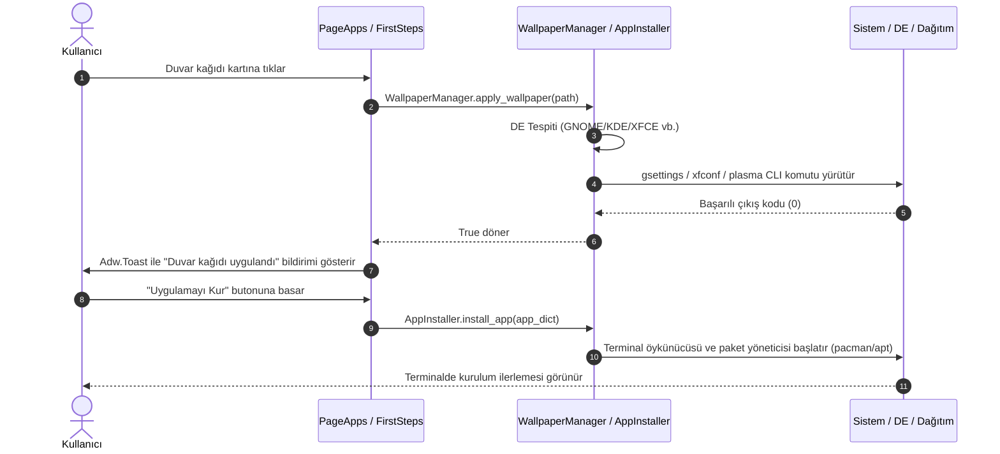

# Pars Linux Welcome - Sistem ve Yazılım Mimarisi (`ARCHITECTURE.md`)

Bu belge, **Pars Linux Welcome** (`pars-welcome`) uygulamasının mimarisini, katmanlı yazılım tasarımını, bileşenler arası veri akışını ve sistem entegrasyonlarını ayrıntılı olarak açıklamaktadır.

---

## 1. Yüksek Düzey Mimari (High-Level Architecture)

Pars Linux Welcome, modern Linux masaüstü ortamlarına sorunsuz uyum sağlayabilmesi için **GNOME HIG (Human Interface Guidelines)** ilkelerine dayalı, **GTK4** ve **Libadwaita** (`Adw 1`) kütüphaneleri kullanılarak geliştirilmiştir.

Uygulama, iş mantığı ile kullanıcı arayüzünü kesin sınırlarla ayıran iki ana katmandan oluşur:

```text
+-----------------------------------------------------------------------------------+
|                        KULLANICI OTURUMU (Unprivileged User)                      |
|                                                                                   |
|  +-----------------------------------------------------------------------------+  |
|  |                  Giriş ve Uygulama Yönetimi (Entrypoint)                    |  |
|  |     pars-welcome  -->  src/Main.py (Adw.Application & Gtk.CssProvider)      |  |
|  +-----------------------------------------------------------------------------+  |
|                                          |                                        |
|                                          v                                        |
|  +-----------------------------------------------------------------------------+  |
|  |                     Arayüz Katmanı (src/ui - Libadwaita)                    |  |
|  |   - MainWindowAdw.py : Adw.HeaderBar, Adw.ViewSwitcher, Adw.ToastOverlay    |  |
|  |   - PageWelcome.py   : Karşılama Banner, Sistem Donanım Özet Kartları       |  |
|  |   - PageFirstSteps.py: Renk Şeması, Duvar Kağıdı Şeridi, Ekran Ayarları     |  |
|  |   - PageApps.py      : apps.json Kataloğu, Arama, Dinamik Kur/Aç Butonları  |  |
|  |   - PageCommunity.py : links.json Topluluk & Destek Yönlendirmeleri         |  |
|  |   - widgets/         : InfoCard.py, WallpaperDialog.py                      |  |
|  +-----------------------------------------------------------------------------+  |
|                                          |                                        |
|                                          v                                        |
|  +-----------------------------------------------------------------------------+  |
|  |                     Çekirdek Servis Katmanı (src/core)                      |  |
|  |   - SystemInfo.py       : OS, Kernel, DE, CPU, RAM, Disk Alanı Tespiti      |  |
|  |   - AutostartManager.py : XDG ~/.config/autostart ve JSON Konfigürasyonu    |  |
|  |   - WallpaperManager.py : Evrensel Duvar Kağıdı Taraması ve Uygulayıcısı    |  |
|  |   - DesktopActions.py   : Tema Değişimi, Ekran Ayarları, Sistem Güncelleme  |  |
|  |   - AppInstaller.py     : Dinamik Paket Tespiti ve Terminal Runner          |  |
|  |   - I18n.py             : GNU gettext Çoklu Dil Yerelleştirme Motoru        |  |
|  +-----------------------------------------------------------------------------+  |
|                                          |                                        |
|                                          v                                        |
|  +-----------------------------------------------------------------------------+  |
|  |                      Sistem Katmanı (OS & FreeDesktop)                      |  |
|  |   - XDG D-Bus API'leri, GSettings / Dconf, pacman / apt / flatpak, FreeDesktop |
+-----------------------------------------------------------------------------------+
```

---

## 2. Dizin ve Modül Yapısı

```text
parslinux-welcome/
├── pars-welcome              # Çalıştırılabilir ana betik (/usr/bin/pars-welcome)
├── run.sh                    # Geliştirme ortamı başlatıcısı (oturum temizleyicili)
├── build-i18n.sh             # gettext PO/MO derleme betiği
├── PKGBUILD                  # Arch Linux / Pars Linux resmi paket tarifi
├── data/                     # Statik veri ve varlıklar
│   ├── apps.json             # Önerilen uygulamalar kataloğu
│   ├── links.json            # Topluluk ve destek bağlantıları
│   ├── style.css             # GTK4 / Libadwaita W3C CSS stil dosyası
│   ├── org.parslinux.welcome.desktop # FreeDesktop başlatıcı
│   ├── org.parslinux.welcome.svg     # Vektörel uygulama simgesi
│   ├── icons/apps/           # Popüler uygulamaların bağımsız SVG ikonları
│   ├── locale/               # Derlenmiş ikili gettext (.mo) katalogları
│   └── wallpapers/           # Pars Linux özgün 1080p SVG duvar kağıtları
├── po/                       # Çeviri kaynak dosyaları (.pot, .po)
├── src/                      # Kaynak kodlar
│   ├── Config.py             # Yollar, sabitler ve konfigürasyon yöneticisi
│   ├── Main.py               # Adw.Application ve Gtk.CssProvider başlatıcı
│   ├── core/                 # Çekirdek servisler ve sistem motorları
│   │   ├── AppInstaller.py
│   │   ├── AutostartManager.py
│   │   ├── DesktopActions.py
│   │   ├── I18n.py
│   │   ├── SystemInfo.py
│   │   └── WallpaperManager.py
│   └── ui/                   # Kullanıcı arayüzü modülleri
│       ├── Icons.py          # Gömülü SVG ikon sağlayıcı ve önbellek
│       ├── MainWindowAdw.py  # Ana pencere ve navigasyon
│       ├── pages/            # ViewStack sayfaları
│       │   ├── PageWelcome.py
│       │   ├── PageFirstSteps.py
│       │   ├── PageApps.py
│       │   └── PageCommunity.py
│       └── widgets/          # Yeniden kullanılabilir arayüz bileşenleri
│           ├── InfoCard.py
│           └── WallpaperDialog.py
└── tests/                    # unittest test takımı
    └── test_welcome.py
```

---

## 3. Katman Sorumlulukları

### A. Giriş ve Yaşam Döngüsü (`src/Main.py`, `src/Config.py`)
- `ParsWelcomeApp`, `Adw.Application` sınıfından türetilmiştir ve tekil örnek (single-instance) D-Bus modelini kullanır.
- `do_startup()` evresinde:
  1. `I18n.init_i18n()` ile kullanıcının dil tercihi yüklenir.
  2. `data/style.css` dosyası `Gdk.Display.get_default()` üzerine `Gtk.STYLE_PROVIDER_PRIORITY_APPLICATION` önceliğinde eklenir.
  3. Kayıtlı tema modu (`light`, `dark` veya `system`) `Adw.StyleManager` üzerinden uygulanır.
- `do_activate()` evresinde ana pencere (`MainWindowAdw`) ayağa kaldırılarak ekrana getirilir.

### B. Arayüz Katmanı (`src/ui/`)
- **`MainWindowAdw`**: Pencere üstünde `Adw.HeaderBar`, `Adw.ViewSwitcher` ve alt alanda sürüm bilgisi ile `Adw.ToastOverlay` taşır.
- **`PageWelcome`**: Sistem karşılama kahraman alanı (hero banner), hızlı kısayollar (Paket Güncelleyici, Sistem Ayarları) ve `InfoCard` bileşenleriyle CPU, Bellek, Disk ve DE bilgilerini sunar.
- **`PageFirstSteps`**: Tema seçimi, 4 adet öne çıkan Pars Linux duvar kağıdı kartı, tam ekran duvar kağıdı galerisi tetikleyicisi, ekran çözünürlüğü ve dil seçici (`Gtk.DropDown`).
- **`PageApps`**: `apps.json` dosyasını kategorilere ayırarak listeler. Canlı arama filtresi (`Gtk.SearchEntry`) sunar. Sistemde kurulu olanları otomatik tespit ederek "Yüklü" rozeti basar.
- **`PageCommunity`**: Forum, Telegram, Web Sitesi, Kaynak Kod ve Katkı bağlantılarını grid düzeninde sunar.
- **`WallpaperDialog`**: Kategori filtreli (Hepsi, Pars Linux, Doğa, Soyut, Minimal) ve kullanıcının özel resim seçebileceği dosya seçicili modal pencere.

### C. Çekirdek Servis Katmanı (`src/core/`)
- **`SystemInfo`**: `/etc/os-release`, `uname -r`, `/proc/cpuinfo`, `free -m`, `statvfs` ve `XDG_CURRENT_DESKTOP` ortam değişkenlerinden güvenli ve hızlı donanım tespiti yapar.
- **`AutostartManager`**: `~/.config/autostart/org.parslinux.welcome.desktop` dosyasını ve `~/.config/pars-welcome/config.json` dosyasını FreeDesktop standartlarına göre yönetir.
- **`WallpaperManager`**: GNOME (`gsettings`), KDE Plasma (`plasma-apply-wallpaperimage`), XFCE (`xfconf-query`), Cinnamon, MATE, LXQt, Hyprland (`hyprctl hyprpaper`), Sway (`swaybg`) ve X11 (`feh`/`nitrogen`/`xwallpaper`) için evrensel arka plan uygulama komutlarını çalıştırır.
- **`AppInstaller`**: Sistemde `pacman`, `apt`, `flatpak` varlığını sorgular; uygulamayı kurmak için kullanıcının kurulu terminalini (`gnome-terminal`, `ptyxis`, `konsole`, `xfce4-terminal`, `xterm`) açar.
- **`I18n`**: GNU `gettext` altyapısı ile çalışma anında `set_language("system"|"tr"|"en")` çağrısıyla arayüz dilini değiştirir.

---

## 4. Veri Akışı ve Olay Yönetimi



---

## 5. Güvenlik ve Ayrıcalık Ayrımı (Security & Privileges)

- **Root Yetkisi İstememe Prensibi:** `pars-welcome` kullanıcı oturumunda çalışır (`UID > 1000`). Kesinlikle `sudo` veya `pkexec` ile doğrudan çalıştırılmamalıdır.
- **Paket Kurulumu:** Sistem seviyesi paket kurulumları gerektiğinde, yetkilendirme `AppInstaller` tarafından başlatılan terminal içerisinde `sudo` veya `pacman`/`apt` yetki mekanizması üzerinden kullanıcıya sorulur.
- **XDG Güvenliği:** Yapılandırma dosyaları yalnızca kullanıcının ev dizini (`~/.config/pars-welcome/`) altında güvenle saklanır.
